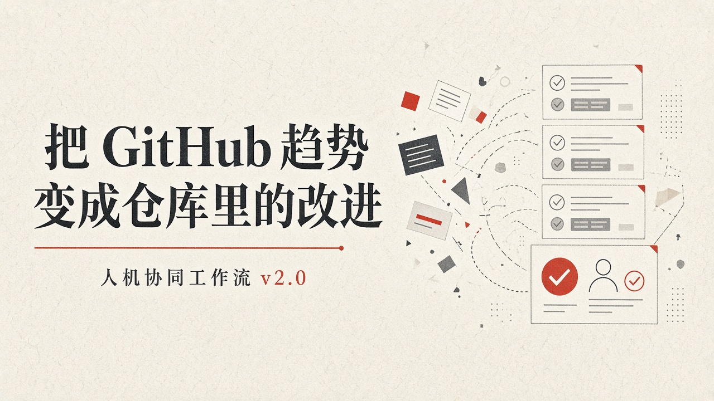

# 公众号文章归档

这是张路存放自己公众号文章的仓库：已定稿的 Markdown 正文、封面、配图和微信兼容排版，以及之后新文章的归档位置。

它不是 [md2wechat](https://github.com/geekjourneyx/md2wechat-skill) 官方项目，也不是该仓库的 fork。md2wechat 只作为本机外部命令使用，基线固定为 `@geekjourneyx/md2wechat@3.8.0`。文章版权归作者。本仓库没有全仓开源许可证，权利说明见 [NOTICE.md](NOTICE.md)。

## 文章

### 把 GitHub 趋势变成自己仓库的改进

[](articles/2026/2026-11-15-github-trend-workflow/article.md)

| 项 | 内容 |
| --- | --- |
| 作者 | 张路 |
| 来源 | https://trend.zhanglu.net/workflow |
| 版本 | v2.0，定稿日 2026-11-15 |
| 首发日期 | 2026-10-18 |
| 状态 | 已发布 |
| 正文 | [article.md](articles/2026/2026-11-15-github-trend-workflow/article.md) |
| 微信兼容 HTML | [article.html](articles/2026/2026-11-15-github-trend-workflow/article.html) |
| 选用封面 | [cover-magazine-16x9.jpg](articles/2026/2026-11-15-github-trend-workflow/assets/cover-magazine-16x9.jpg)（杂志风，1280×720） |
| 元数据 | [metadata.yaml](articles/2026/2026-11-15-github-trend-workflow/metadata.yaml) |

正文有八章、五个案例、三张表。上图是这篇实际选用的杂志风封面。备选两张没有用于这篇草稿：[cover-option-dark-isometric-16x9.jpg](articles/2026/2026-11-15-github-trend-workflow/assets/covers-optional/cover-option-dark-isometric-16x9.jpg)（暗色等轴测）和 [cover-option-minimal-line-16x9.jpg](articles/2026/2026-11-15-github-trend-workflow/assets/covers-optional/cover-option-minimal-line-16x9.jpg)（极简线条），都在 `assets/covers-optional/`。

机器可读索引：[articles/index.yaml](articles/index.yaml)。

## 从审稿到草稿箱

顺序固定。前一步没完成，不进入后一步。命令细节和边界见 [docs/workflow.md](docs/workflow.md)。

1. 改编辑源 `article.md`。保留已审核的表述、数字、技术标识和来源。
2. 在本地打开 `article.html` 看排版。这一步不调用微信。
3. 作者选定草稿标题，并从准备好的封面里选一张。
4. 确认正文配图。信息图保留公开 SVG，微信正文使用转出的 PNG。
5. 作者明确同意后，才用官方 CLI 上传选定封面和正文图，并 `create_draft` 写入草稿箱。
6. 作者在公众号后台自己发布。创建草稿不会群发。

不购买 `MD2WECHAT_API_KEY` 时，排版用：

```bash
md2wechat convert article.md --mode ai --theme custom --json
```

v3.8.0 里，这条命令把排版提示交给宿主，返回 `CONVERT_AI_REQUEST_READY`，不写出最终 HTML，不上传图片，也不创建草稿。宿主再在本地写成带内联样式的 HTML。不写 `--mode` 的 `convert` 默认是付费 API 模式。API 主题 `default` 与 `--mode ai` 类型不符，不能放在同一次命令里。付费 API 仍是可选项，购买与否都不等于整套 CLI 免费，也不等于取得上游商业授权。

`md2wechat config validate` 和 `md2wechat doctor` 只说明本机配置能否加载、以及草稿凭证等是否看起来齐全。它们不调用微信，不能证明公众号身份或 IP 白名单已经正确。

## 目录

```text
articles/     按年、按日期 slug 存放的文章、元数据和图片
templates/    下一篇可复制的正文和元数据模板
docs/         归档约定，以及不购买排版 API Key 的投稿笔记
scripts/      只读本地检查，不访问网络
NOTICE.md     文章版权和上游 md2wechat 许可归属
```

| 入口 | 文件 |
| --- | --- |
| 归档约定 | [docs/archive.md](docs/archive.md) |
| 投稿笔记 | [docs/workflow.md](docs/workflow.md) |
| 正文模板 | [templates/article.md](templates/article.md) |
| 元数据模板 | [templates/metadata.yaml](templates/metadata.yaml) |
| 权利与上游许可 | [NOTICE.md](NOTICE.md) |

## 写下一篇

1. 建目录 `articles/<四位年份>/<YYYY-MM-DD>-<英文短横线 slug>/`。日期用这一版定稿日。
2. 复制 [templates/article.md](templates/article.md) 和 [templates/metadata.yaml](templates/metadata.yaml) 进去，放上选用封面；备选封面单独放在 `assets/covers-optional/`。
3. 在 [articles/index.yaml](articles/index.yaml) 写上标题、作者、来源、定稿日和状态。状态用 `drafting`、`draft_created_unpublished`、`published` 或 `withdrawn`。
4. 运行检查：

```bash
python3 scripts/verify_archive.py
```

脚本只读工作区：核对索引、元数据、相对图片路径和表格，并扫描已跟踪文件里的凭证形态。它不调用微信，不读取密钥，也不安装外部工具。

## 安全

凭证只放在环境变量 `WECHAT_APPID`、`WECHAT_SECRET`，或本机 `~/.config/md2wechat/config.yaml`。不要把真实 AppID、AppSecret、API Key、草稿标识、素材标识、微信图床地址或出口 IP 提交进仓库。`draft.json` 和已换成微信图床地址的正文已被 `.gitignore` 排除。

本仓库没有自动发布、定时任务，也没有携带微信凭证的 CI。发布由作者在公众号后台自己完成。

## 上游许可

外部依赖是 [geekjourneyx/md2wechat-skill](https://github.com/geekjourneyx/md2wechat-skill)。2026-11-15 核对时，`VERSION`、`package.json` 和官方 [安装说明](https://github.com/geekjourneyx/md2wechat-skill/blob/main/docs/INSTALL.md) 都是 3.8.0。

该版本的许可证是 md2wechat Source Available License，基于 BUSL-1.1。变更日 2030-01-01 起转为 Apache-2.0；若某一版本公开满四周年更早，则从较早日期起转换。3.8.0 不按 MIT 使用或再分发。本仓库不复制上游源码、主题、提示词或技能。完整边界见 [NOTICE.md](NOTICE.md) 和上游 [LICENSE](https://github.com/geekjourneyx/md2wechat-skill/blob/main/LICENSE)。
