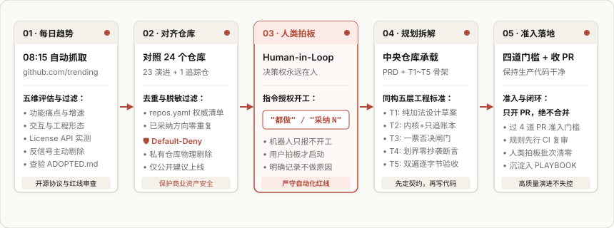

# 把 GitHub 趋势变成自己仓库的改进

从“每天刷完就忘”到“24 个仓库同构演进、单批 115 个 PR 闭环合入”：跑满一个月后，我们把这套人机协同流水线迭代到了 v2.0。

作者：张路 ｜ 2026-10-18 首发 · 2026-11-15 满月实战更新（v2.0） ｜ 自动化支持：Agent 趋势引擎

- 🛡️ 铁律：只开 PR 不合并 + 落 PR 四道准入门槛
- 纳管规模：24 仓 · 441 PRD
- 工程标准：T1–T5 五层同构骨架

> 📦 **v2.0 满月实战升级 & 配套 Skill**：本文在跑通初期版本一个月后重写升级，新增**落 PR 四道准入门槛（`default_pr_gate`）**、**T1–T5 同构五层工程骨架**、横切全仓的 **Agent 可信治理七步链**，以及**反信号剔除与老债清账纪律**。访问 [趋势工作流 Skill 页面](https://trend.zhanglu.net/skills)（或在终端运行 `npx skills add zhanglunet/trend-workflow`）即可开箱即用。

## 一、为什么要搞这套东西（从“防错过”到“有纪律地吸收”）

GitHub 每天都有新项目上趋势榜，信息过载，看完就忘。

我们的权威清单 `repos.yaml` 目前纳管着 **24 个核心仓库**（**23 个持续演进仓** + **1 个只追踪不上 PR 的上游对照仓**），涵盖 AI 助手、广告投放、表格逆向分析、法务合同预审、投研分析、模型代理、多智能体协同产线、个人知识库、评测看板与运维看板。靠人工盯趋势、提方案，根本忙不过来。

第一周我们造出这条 **趋势 → 建议 → 采纳 → PRD → 任务 → PR** 流水线，解决的是“好点子看一眼就流走”。

而接下来满月的真实工程实践，则把重心推向了更深一步：如何防止自动化 Agent 往业务仓库里塞“找不到调用入口的悬浮代码”，以及如何让二十多个异构仓库在统一工程约束下同构演进、批次日清。

## 二、工作流全貌：端到端信息图与 T1–T5 五层同构骨架

信息图出处：张路，公开原件 https://trend.zhanglu.net/brand/workflow-infographic.svg 。本地副本为同目录 SVG；微信兼容正文使用 assets/workflow-infographic.png。

1. 每天 08:15 自动巡航抓取 github.com/trending，并做 License API 实测。
2. 先查 `ADOPTED.md` 去重，剔除违背合规底线的「反信号」。
3. 对照 `repos.yaml` 中的 24 个仓库出改进建议（公开站 Default-Deny 物理脱敏）。
4. 人：决策拍板（“都做” / “采纳第 N 条” / 拒绝并写明原因）。
5. Agent（可用 Muse / Grok bot / Claude Code / Codex / Antigravity 驱动）：先建 5 个真实 issue（T1–T5）→ 写 PRD 编号入库 → T1 纯加法设计草稿（不碰代码）。
6. 人确认设计后，执行 Step 6.0「落 PR 四道准入门槛（`default_pr_gate`）」：
   1. 有模块/函数级真实入口；
   2. 不依赖尚未存在的外部渠道；
   3. 查重，不另起重复轮子；
   4. 附开发记录，且需要留痕的状态必须落库。
7. 过门才落目标仓库（严格遵守：只开 PR，绝不擅自合并）。
8. 分仓库讨论组 + 规则/CI 复审 → T2 内核 → T3 闸门 → T4 划界 → T5 双遍逐字节验收。
9. 人类逐批批准合并 → 单批 23 仓 × 5 层（115 个 PR）当批闭环归零 → 模式沉淀入 `PLAYBOOK.md`。

核心升级成两句话：**中央仓库管规划，目标仓库过门槛后才收 PR，合并权永远在人手里。**

对早期的“T1–T5 拆包”，v2.0 进一步固化为跨仓库通行的**同构五层工程骨架**：

| 层级 | 角色定位 | 硬性约束与验收密度 |
| --- | --- | --- |
| T1 · 设计草稿 | 只定契约，不写实现代码 | 纯加法文档落目标仓 `docs/plans/`，写死接入点（模块+函数）、数据流、拒绝边界与借鉴声明。 |
| T2 · 核心实现 | 纯函数内核 + 只追加账本 | 核心逻辑不靠脆弱魔法；状态与决策写入 append-only JSONL 账本并经统一 outlet 出口包装（标配 12+ 单测）。 |
| T3 · 一票否决闸门 | 动作前与出口前的硬拦截 | 校验账本 append-only 不漂移（防篡改）、关键裁决双向对账、未全判齐直接阻断（`REVIEW_INCOMPLETE`），异常零静默（标配 11+ 单测）。 |
| T4 · 划界断言 | 边界隔离与零抄袭防线 | 断言下游业务载体零越界导入、静态扫描源码确保对被借鉴开源仓零符号导入（仅借鉴形态，不搬代码），钉死关键红线阈值（标配 7+ 单测）。 |
| T5 · 确定性全链验收 | 端到端闭环证明 | 全链连跑两遍要求产物逐字节一致 + 三路失败演练 + 密钥扫描零泄露（标配 6+ 单测）。 |

## 三、九个关键工程设计（含满月踩坑进化）

1. **一个中央仓库管所有 + `repos.yaml` 权威清单**：私有的中央仓库承载所有 PRD、任务 issue、设计草稿、日报原文、账本看板与清单；`repos.yaml` 统一声明 24 个纳管仓库的角色（23 个 `improve` + 1 个 `track`）与准入策略。目标仓库里只留下干净的 PR 和 `docs/plans/`。

2. **推荐前先查 `ADOPTED.md` 与日报台账**：截至第 30 天，`ADOPTED.md` 已登记至 `PRD-441`。每次日报生成前必须核验历史已采纳与已拒绝条目，防止 AI 把十天前做过的方案换个马甲再推一遍。

3. **严格的隐私脱敏防护（Default-Deny）**：公开站构建期对非白名单的商业私有仓库建议执行物理剔除与全产物扫描；哪怕正文偶发提及私有仓库代号或链接，自动化测试也会直接阻断构建，确保公开站零敏感资产暴露。

4. **新增第 6 条铁律 · 落 PR 四道准入门槛（`default_pr_gate`）**：这是踩过真实大坑后立下的规矩。2026-11-11，我们在检查某业务投放系统仓库时，不得不一次性关闭了 10 个此前开出的 PR：它们有的是“写了一个模块但全仓找不到调用入口”，有的是“重复造了已有模块”，有的是“审计账本只存内存、进程一退就丢”，还有的依赖尚未接入的外部发布渠道。

   自那天起，Step 6.0 强制要求逐仓核验四道硬门槛（支持在 `repos.yaml` 中按仓微调覆盖）：

   - `require_integration_point`：PRD 必须具体到模块与函数，写明谁调用它（API / CLI / MCP / DAG）；
   - `no_missing_channel`：禁止依赖目标仓库尚未建立的外部渠道或平台；
   - `no_duplicate_module`：开 PR 前必查 `main` 分支同名/同类模块，有则扩展既有模块，绝不另起炉灶；
   - `impl_requires_devlog`：T2–T5 实现必须按仓约定附带开发记录与合规核对表，需要留痕的状态必须落盘落库。

   任一不满足，只保留中央仓设计文档并写明卡点，绝不在目标仓库制造悬浮 PR。

5. **只开 PR 不合并 + 分仓并行交付**：所有自动化只做到“开 PR 并自验全绿”为止。即便后来演进到单批次 23 个仓库 × 5 层共 115 个 PR 并行开出，每一层的合并按钮依然全部由人类审阅后授权拍板。

6. **许可证实测红线与 T4 零符号扫描**：借鉴思路可以，抄代码不行。流水线强制调用 GitHub License API 实测，不轻信 README 手写徽章。

   除了早期踩过的 `Coqui TTS`（以为 MIT，实测 MPL-2.0）、`VoiceStudio` 与 `we-promise/sure`（AGPL-3.0）、`Veyra-NRVideo`（GPL-3.0）外，我们还实测发现：连大热的官方仓库 `anthropics/skills` 在当时都没有 LICENSE 文件（默认保留全部权利），以及编辑器 `zed` 属于含 GPL-3.0 的双许可——一律标红，只借工作流形态，源码与文本一行不抄，并在 T4 划界测试中用代码符号扫描自动化兜底。

7. **反信号识别（热门不等于适合）**：趋势榜第一名不代表必须跟进。例如一周暴涨上万星的跨社交网络用户名追踪工具 `sherlock`、反反爬抓取工具 `Scrapling`，与我们自有信息采集仓库“来源词表封闭、反爬拒绝显形、零伪装”的合规红线正面冲突。日报中明确将其归为反信号（只记录趋势，严禁立项跟进），反向用来加固边界测试。

8. **按仓库分房间评审 + 在途 PR 逐批清零**：20+ 个仓库各有独立评审通道，CI（如 ruff / mypy / 契约检查）先扫干净格式与叠层冲突；人类拍板批次后，同一批次在途 PR 集中合并归零，绝不积压成“无人认领的幽灵 PR 坟场”。

9. **STATS 量化与定期“废案清账”**：不仅统计“建议数 → 采纳数 → 落地 PR 数”，还要敢于啃老账。

   第 4 周我们对早期（`PRD-001~120`）遗留 issue 做了一次逐仓全量审计：已交付批次的 200 个记账 issue 逐单挂载真实合并 PR 核销；而制度定型前留下的 66 个“从未动工或仅部分交付、已失锚”的老 PRD（共 200 个遗留单）果断留痕废案关单，绝不为了账面好看留着僵尸单凑虚荣数字。

## 四、PLAYBOOK 演进：8 条基础模式 + Agent 可信治理七步链

第一个星期，`PLAYBOOK.md` 帮我们固化了 8 条高频好用的基础模式。

而到了第 3–4 周，流水线进化出了更有威力的一步：不再只是单个仓库零敲碎打，而是每天提炼一个贯穿架构短板的统一工程母题，经过 T1–T5 同构骨架横切落进全部 23 个活跃演进仓，最终拼成了一条互不重复、环环相扣的 Agent 可信治理七步链。

### 4.1 基础工程模式（第 1 周沉淀，新仓库直接套用）

1. 标准 SKILL.md：description 放用户口语触发词（如“公式断在哪”），顶部 30 秒速览。验收：盲测 agent 能否不经提示正确调用。
2. 只读 MCP：先做只读 scope 的 MCP tools，不做写入，附错误码表和限流。
3. 官方插件市场发布：对齐官方 marketplace.json schema，大包拆小，plugin.json 路径跟官方一致，skill 用实份拷贝。
4. 自维护 Wiki：经验层独立，条目 schema（标题/来源/置信度/状态/标签 + 正文≤300 字），草稿人工确认才入库。
5. 摘要模式：三段式摘要（schema/统计/异常 Top N），强制标注“完整数据在原表”，配开关可回退全量。
6. 独立验收测试：每个 skill 三层测试（契约/示例/反例），CI 集成。
7. Harness 生成器：`capability.yaml` 一键生成 CLI + SKILL.md 草稿（不编造业务语义）。
8. Skill 链拆分：大 skill 按阶段拆成独立 skill，段间用 JSON Schema 定契约。

### 4.2 满月进阶：横切 23 个演进仓的「Agent 可信治理七步链」

当系统里跑起越来越多自动化 Agent，单点小聪明已不够用——必须回答七个连环拷问：

1. 改坏了能退回吗？
2. 传上下文不复制走样吗？
3. 事后能原样重算吗？
4. 人去哪一处批完？
5. 扫描误报谁来验？
6. 一起改时看得见吗？
7. 交卷前谁先用硬规则扫一遍？

这七个统一主题沿时间线正交串联如下：

| 治理环节 | 解决的信任痛点 | 借鉴开源形态（许可证隔离） | 工程边界与核心机制 |
| --- | --- | --- | --- |
| ① 可逆改动包 10-28 批次 | 改坏配置或资产回不去 | `cleanyourtv` 先备份再变更、一键还原形态 | 改工具、配置或数据前先打事前快照，附确定性一键还原包（区别于知识层的 Wiki 版本回滚）。 |
| ② @引用，不复制 10-29 批次 | 复制粘贴导致原文与副本分叉 | `macro` @-链接工作区形态（⚠️ AGPL-3.0 零代码复用） | 指令下发传 `@句柄` 与内容指纹而非粘贴全文，解析歧义直接停下报错不猜测。 |
| ③ 可重放决策账本 10-30 · PRD-345~358 | 日志只能翻着看，事后算不回原结果 | `CopilotKit/OpenBot`（MIT）+ `AiSOC`（MIT） | 每步关键决策落三件套：输入指纹 + 规则版本与选择依据 + 输出摘要，事后重跑逐字节对不上即出失败证据。 |
| ④ 人工拍板收件箱 11-11 · PRD-359~372 | 人工批准门散落各地，人要四处翻着批 | `backnotprop/plannotator`（Apache-2.0）+ `t3code`（MIT） | 把分散在日志与网关里的待批项只读汇聚进同一张清单，显式 `approve/reject`、拒绝留痕、收件箱自身零自动执行。 |
| ⑤ 先验证，再认账 · 验证台 11-12 · PRD-373~395（23 仓全链） | 扫描器/AI 误报直接灌进收件箱 | `openai/codex-security`（Apache-2.0）+ `cloudflare/security-audit-skill`（MIT） | 站在收件箱上游：每条发现必须先在只读快照或沙箱复现可触发才认账，误报拦在台上不进下游；修复需二次验证才关单。 |
| ⑥ 同屏协同会话 11-13 · PRD-396~418（23 仓全链） | Agent 静默改完才丢结果，协作过程黑盒 | `zed` 多人协同（GPL 双许可只借形态）+ `agent-browser`（Apache-2.0） | 人与多 Agent 同屏看同一件产物：每次 `propose/accept/reject` 带操作人署名、未接受绝不落地主产物，并发带文件锁防竞争。 |
| ⑦ 规则先行，模型后判 · 评审流水线 11-14 · PRD-419~441（23 仓全链） | 纯靠 LLM 评审“自由发挥”，漏报与瞎判并存 | `alibaba/open-code-review`（Apache-2.0）+ `google/elephant-goldfish-model`（Apache-2.0） | 本地纯函数确定性规则先复算扫出候选（数字/口径/行号锚点）→ 注入 `judge_fn` 只判规则命中项（漏判即报 `REVIEW_INCOMPLETE`），任一确认风险即阻断出口。 |

## 五、实战案例：借鉴了哪些趋势项目

很多人好奇：每天看 GitHub 趋势，到底能给自己的项目带来什么实质改变？是不是把别人的开源代码 Copy-Paste 过来？

当然不是。不同项目的业务场景千差万别，但优秀的设计思路、工程约束与产品解法是完全相通的。这套流水线的核心价值，就是把别人在成千上万个 Star 里摸爬滚打摸索出的「顿悟时刻」，迅速转化为解决我们自身老毛病的方案。以下挑 5 个最典型、最接地气的真实故事：

**案例 1 · 算力与成本**

### 解决「大表爆 Token」：从单次请求烧几块钱，到 1.5 秒极速返回

**😣 以前的痛点**

在做表格分析助手时，用户随手扔进一张 5 万行的销售流水或财务明细。如果一股脑全塞给大模型，要么触发 `Context Window Exceeded` 报错崩溃，要么一次 API 请求烧掉好几块钱、在屏幕前干等十多秒。

**💡 趋势给的灵感**

那天趋势榜上出现了一个极度克制的项目 `mksglu/context-mode`。它提出了「Token 经济学」：人看财务报表时，也不会从第 1 行逐字读到第 5 万行；人总是先看目录、核心均值、汇总数据，发现哪项不对劲再翻账本。

**🛠️ 我们的落地动作**

流水线当天立项 PRD，在仓库中补齐了纯前端运行的「三段式摘要预处理器」：在把数据喂给 AI 之前，本地先快速提炼出「表头结构 + 基础统计（极值/中位数）+ 离群异常 Top 10」，只把这几百 token 喂给 AI，并附一句“若需深挖某行明细，请指定行号调工具获取”。

**🎯 落地效果**

不仅原本放不下的几十兆大表能秒级处理，单次对话 Token 消耗直降 80%，模型响应时间从 15 秒缩短至 1.5 秒，小模型也能轻松答对。

**案例 2 · 许可证红线**

### 遭遇 7.1 万★的 AGPL 传染协议：借架构形态，代码一行不抄

**👀 眼前一亮的爆款**

趋势榜第一名冲出来一个狂揽 7.1 万 Star 的顶级工具 `debpalash/VoiceStudio`，功能极其惊艳。团队的第一直觉往往是：“这功能太牛了，能不能把它的源码模块挪过来用？”

**🚨 许可证红线报警**

自动化流程的第一道卡点就是调用 GitHub License API 实测，当场亮起红灯：AGPL-3.0 协议。这是一种义务较重的开源协议；具体会不会、以及在多大范围内产生开源传染义务，取决于使用和分发方式，需要先核对许可证和具体使用方式，必要时做合规评估。不宜简单理解为“抄了一行就必须把整套应用甚至后端全部开源”。我们的原则是优先借鉴思路，而不是直接复制代码。

**🛠️ 我们的落地动作**

借其神韵，不碰其皮肉。我们拆解它为什么受开发者欢迎，发现最精妙的是它将底层能力封装为干净的「只读 MCP（Model Context Protocol）服务」。当天流水线输出设计草稿，团队自己用原生干净代码重新实现了只读 MCP 协议适配层，代码复用度为 0。

**🎯 落地效果**

既让自有工具用上了与该项目同类的调用体验，又尽量守住代码边界与开源合规底线；但这仍需按具体使用方式做合规评估，而不能认为从此没有法律风险。

**案例 3 · 工具调用**

### 冷冰冰的命令行加上「30 秒说明书」：Agent 成功率从 65% 到 95%

**😣 以前的痛点**

团队维护了许多命令行小工具（查模型可用性、查表格结构等），但命令行参数极多（`--flag`、`--mode`、JSON 管道）。不仅人类容易忘，AI Agent 调起来也经常由于参数猜错而频频报错。

**💡 趋势给的灵感**

5.3 万 Star 的 `HKUDS/CLI-Anything` 之质变在于彻底定义了「什么是给 Agent 看的说明书」：每个命令行都要配标准的 `SKILL.md`，顶层包含用户口语触发词（如“公式在哪断了”），随附 30 秒能跑通的极简样例。

**🛠️ 我们的落地动作**

流水线为多个工具仓库同时建 issue、开 PR：统一重构 `SKILL.md` 规范，用真实口语写触发词，并在 CI 中加入「盲测自动化用例」——不给 Agent 任何隐藏 System Prompt，看它能否只凭说明书一次调对。

**🎯 落地效果**

不仅人类开发者看着清晰，Agent 工具调用的首发成功率直接从 65% 跃升到了 95% 以上，完全省去了反复纠错的死循环。

**案例 4 · 质量与可信**

### 治好 AI 的自信胡说：交卷前强制执行「反思三问」

**😣 以前的痛点**

让 AI 协助做合规审查、代码审核或业务校验时，它经常「一本正经地胡说八道」：明明条款里没写，它硬生生脑补出一个严重违规；或者自己推导错了，还言之凿凿。人类评审必须字斟句酌地二次核对，心力交瘁。

**💡 趋势给的灵感**

借鉴趋势项目 `iFixAi` 的自我纠错机制：把模型换得再大，不如在回答前加一道自我闭环。

**🛠️ 我们的落地动作**

在审查流水线的末端增加强制性的「自审计反省卡点」：在输出最终结论前，模型必须对自己的草稿回答 3 个问题：

1. 这个结论精准对应原文第几行？（找不到出处必须作废）；
2. 是否包含主观臆测词汇？
3. 是否与之前给出的事实矛盾？

**🎯 落地效果**

输出的审查误报率断崖式下降，人类只需要扫一眼它标注的「原文对应行」就能快速完成核准，彻底摆脱了“帮 AI 擦屁股”的焦虑。

**案例 5 · 评审与降噪（v2.0 新增）**

### 规则先行、模型后判 + 验证台复现：撑起单批 115 个 PR 的高质量流水线

**😣 以前的痛点**

纳管扩大到 23 个演进仓后，每个仓都在产出分析报告、广告素材、合同草稿、周报、运维配置。如果全靠 LLM 通读上下文评审，不仅烧算力，还会制造大量无法复算的模糊“建议”；而安全与质检扫描器又容易堆出满屏误报，把人工拍板队列淹没。

**💡 趋势给的灵感**

11-12 至 11-14 连续上榜的两股趋势合力指明方向：`openai/codex-security`（Apache-2.0）强调“发现先在沙箱验证可触发才认账”，而登顶日榜第一的 `alibaba/open-code-review`（Apache-2.0）与 `google/elephant-goldfish-model`（Apache-2.0）则主打「确定性流水线先扫，LLM 只判命中候选」。

**🛠️ 我们的落地动作**

工作流连续三天把这两块拼图以 T1–T5 同构骨架横切铺进 23 个演进仓（`PRD-373~441`）：

1. **确定性规则先扫**：本地纯函数先跑数字复算、口径核对、原文行号回指，零大模型介入；
2. **LLM 只判命中项**：通过可注入的 `judge_fn` 逐条复判候选，漏判即报 `REVIEW_INCOMPLETE` 拒绝放行，任一确认风险即触发 outlet 出口拦截；
3. **先验证再进收件箱**：可疑发现先过只读快照或沙箱验证台确认可触发，才送入人类统一的「拍板收件箱」。

**🎯 落地效果**

既把算力与注意力精准聚在真问题上，又把误报拦在人工视线之外。在全链跑两遍逐字节一致与 CI 自动化门禁护航下，实现 11-12、11-13、11-14 连续多个批次 23 仓 × 5 层（单批 115 个 PR）当批闭环合入 `main`、在途归零。

除了上述 5 个典型深度案例，下面是流水线在满月实战期间对照日常趋势持续转化的部分代表性项目清单（累计立项至 `PRD-441`）：

| 流行趋势 | 开源项目的巧妙思路 | 我们的落地改造方案 | 状态与产出 |
| --- | --- | --- | --- |
| HKUDS/CLI-Anything（Apache-2.0） | 标准 Skill 规范与 CLI 口语触发 | 为工具仓库编写标准 SKILL.md，补齐 30 秒盲测用例 | PRD-001/016 已落地 |
| anthropics 官方插件市场 | marketplace.json 生态分发标准 | 将单体大仓库拆分为 5 个独立插件包，支持一键安装 | PRD-003 已上线 |
| Tencent/WeKnora（MIT） | 经验自维护与轻量 Wiki 知识层 | 为分析与合规流水线引入自维护 Wiki 层，记录常见陷阱 | PRD-004/011 已落地 |
| JuliusBrussee/caveman | "说得少、读得少"的极简输出原则 | 重构分析工具输出：非必要不废话，只给结论与行动项 | PRD-040/046 已合入 |
| K-Dense-AI/scientific-agent-skills（MIT） | Skill 三层测试法（契约/示例/反例） | 审查规则技能化，补全 CI 自动化测试集 | PRD-002/012 已合入 |
| debpalash/VoiceStudio（⚠️ AGPL-3.0） | 服务标准化、MCP 协议集成 | 严格规避 AGPL 源码，原生自研只读 MCP 协议层 | PRD-008/042 已合入 |
| morluto/rea（MIT） | 多阶段 Skill 链编排与“证据+限度”输出 | 将臃肿大 Skill 按阶段拆分，用 JSON Schema 传递 | PRD-006 已落地 |
| mksglu/context-mode（⚠️ Elastic 2.0） | Token 经济学与数据渐进加载 | 独立实现三段式摘要预处理，降低 80% 调用开销 | PRD-007/010 已落地 |
| stablyai/orca | Git Worktree 本地多任务并行调度 | 在执行端利用 Git Worktree 支持同一仓库多分支并发开 PR | PRD-005 已合入 |
| iFixAi | 自我修正闭环与反思验证 | 审查流程加入自省三问，有效压制幻觉与虚假报错 | PRD-039 已合入 |
| affaan-m/ECC（MIT） | 本能层 (Instincts) 预编译决策 | 高频无歧义决策规则化预处理，免调 LLM 极致降本 | PRD-055 已合入 |
| CopilotKit/OpenBot（MIT） | 事前定下来、事后可重放的决策账本 | 为关键执行动作补齐输入指纹、规则版本与逐字节重放包 | PRD-345~358 已合入 |
| backnotprop/plannotator（Apache-2.0）+ pingdotgg/t3code（MIT） | 人在环上的控制面与统一待批视图 | 将各仓分散人工闸门只读汇聚为统一「拍板收件箱」，拒绝留痕 | PRD-359~372 已合入 |
| openai/codex-security（Apache-2.0）+ security-audit-skill（MIT） | 安全/质检发现先沙箱复现验证再认账 | 全仓铺设「验证台」，误报在台上拦截、修复二次核验才关闭 | PRD-373~395（115 PR 已合入） |
| zed（⚠️ GPL 双许可，只借形态）+ agent-browser（Apache-2.0） | 同屏实时协同会话与带署名变更流 | 人 + Agent 同屏改同一产物，变更带署名、未接受不落地、带锁防并发冲突 | PRD-396~418（115 PR 已合入） |
| alibaba/open-code-review（Apache-2.0）+ elephant-goldfish-model（Apache-2.0） | 确定性规则先扫 + LLM 仅判命中候选 | 本地规则复算定候选，LLM 只判命中项，不通过由 outlet 阻断出口 | PRD-419~441（115 PR 已合入） |

## 六、跑出来的数据（满月实战账本：2026-10-16 ~ 2026-11-15）

- **441**：PRD 累计立项
- **2,120+**：任务 issue 追踪
- **24**：纳管核心仓库
- **115**：单批全合入 PR 记录

**数字之外，账本必须干净（拒绝虚荣指标）**：一个月累计追踪 issue 已到 `#2129`，并非“只开不关”。

截至 2026-11-15，已交付批次的 200 个记账 issue 已逐条挂载合并 PR 链接核销；同时，我们在第 4 周对制度成型前留下的早期批次（`PRD-001~120`）做了全量真实验证与断舍离——果断将 66 个未动工或仅部分交付、失锚的老 PRD（共 200 个遗留 issue）留痕废案关单，并实现最近三批 23 仓在途 PR 逐批合入归零。

## 七、如果你们也想试（v2.0 人 + Agent 配合建议）

1. **从小开始**：先选 1 个仓库 + 每天 15 分钟看日报，跑通一次“建议 → 拍板 → PRD → T1–T5 → PR”最小闭环。
2. **先定铁律，再设准入门槛**：只开 PR 不合并、T1 先定契约后写代码是放手前提；一旦出现“无调用入口的悬浮 PR”，立刻启用 `default_pr_gate` 四道准入门槛，宁可只留中央设计稿也绝不往业务仓塞死代码。
3. **同构骨架规模化**：当仓库超过 5 个时，尽量用“统一工程母题 + 同构五层（设计 / 内核+账本 / 闸门 / 划界 / 双遍验收）”横切推送，比逐仓零敲碎打好维护十倍。
4. **许可证与反信号双重把关**：调用 License API 实测开源协议，慎用无 LICENSE 文件仓库的源码；与自身合规底线冲突的热门项目（如扫号、绕过反爬）直接归入反信号清单，借此加固自身边界断言。
5. **Bot 与运行时选型非常灵活（支持 Muse、Grok bot 及主流编码 Agent）**：这套工作流通过标准 `SKILL.md` 与仓库契约驱动，不绑定特定专有客户端。既可以由 Muse（擅长多文件上下文与工程步骤规划的 Agent 运行时）或 Grok bot（具备实时网络与开源趋势嗅觉的自动化 Bot）调度执行，也同样适配 Claude Code、Codex、Google Antigravity 等多智能体编排环境。
6. **接受“不做”并定期清账**：记录为什么不做、为什么废案，跟“合并了多少”一样重要——定期清掉僵尸 issue，账本才不会失真。
7. **人的时间只花在刀刃上**：采纳拍板、T1 契约确认、PR 评审合并——把精力死守在这三个高杠杆节点上，其余机械工作全交给流水线。

## 八、一句话总结与 Skill 获取

这套工作流真正解决的不是“怎么让 AI 帮我多写几段代码”，而是“怎么把每天 GitHub 上的工程顿悟，有纪律、可验证、可回滚、不越权地沉淀进自己的每一个仓库”。自动化 Agent 负责把想法变成经过门槛与规则检验的 PR，人永远紧握采纳与合并两把钥匙。

### 🚀 获取完整自动化工具：趋势工作流 Skill

整套流程已固化为符合 Agent Skills 规范的标准包（内含抓取解析、`ADOPTED.md` 去重、`default_pr_gate` 准入门槛核验、脱敏校验与 PRD/T1–T5 模板）。支持通过 Muse、Grok bot 或 Claude Code / Codex 一键接入执行。

[前往查看趋势工作流 Skill 详情页 →](https://trend.zhanglu.net/skills)

`npx skills add zhanglunet/trend-workflow`

来源：张路，《把 GitHub 趋势变成自己仓库的改进（v2.0 满月实战版）》，https://trend.zhanglu.net/workflow 。文中规模、批次与效果数字均为原文作者自述口径，非本文独立核验。
