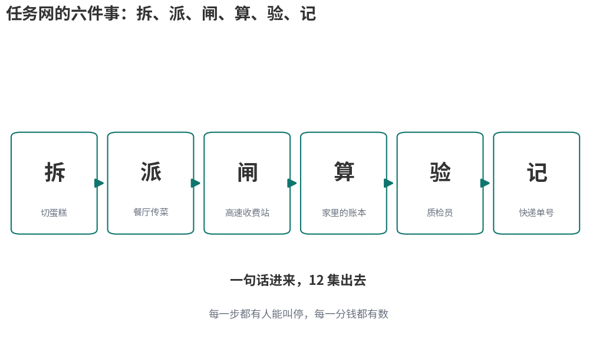
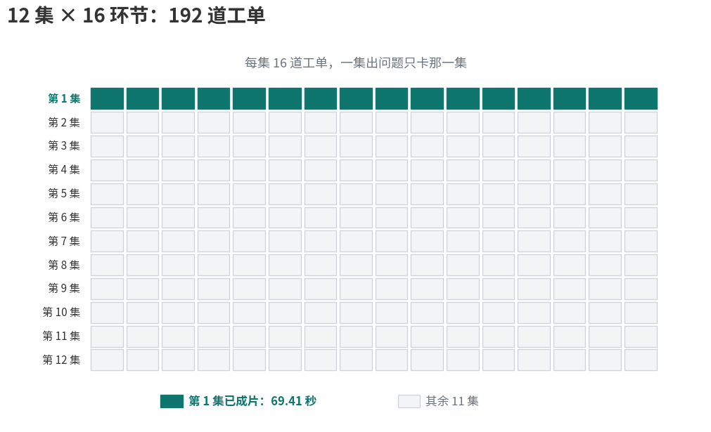
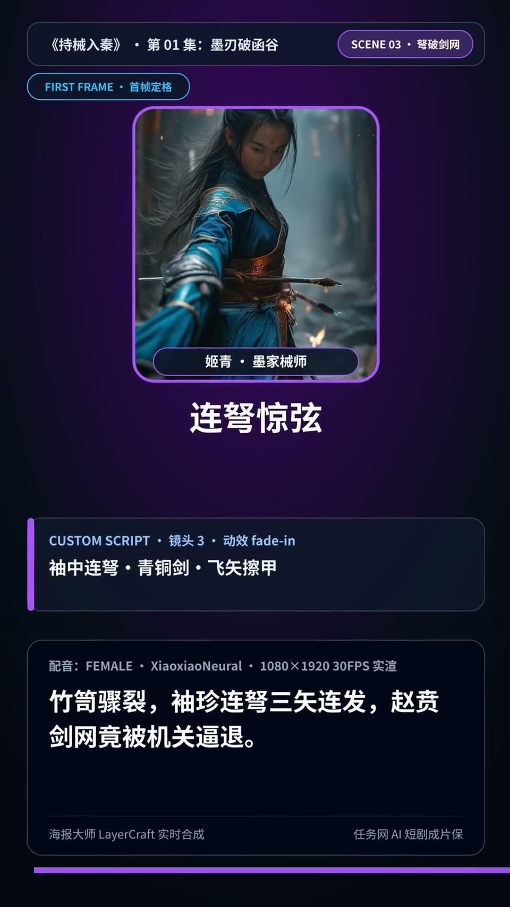
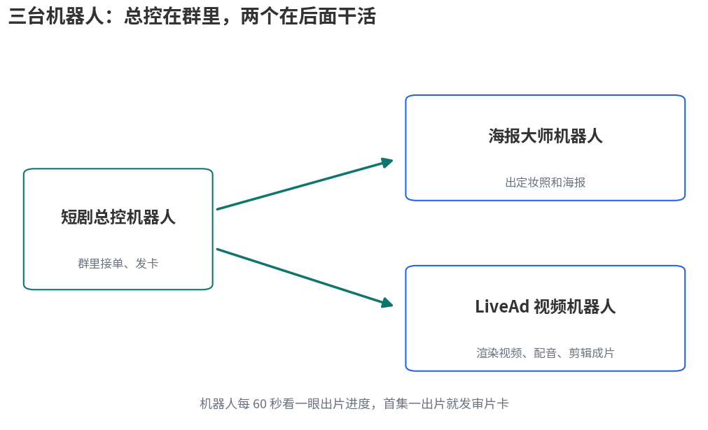
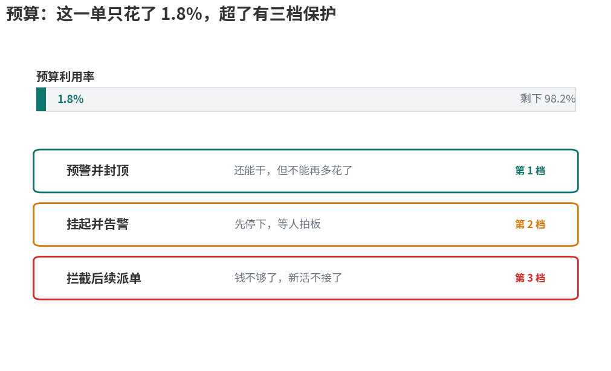
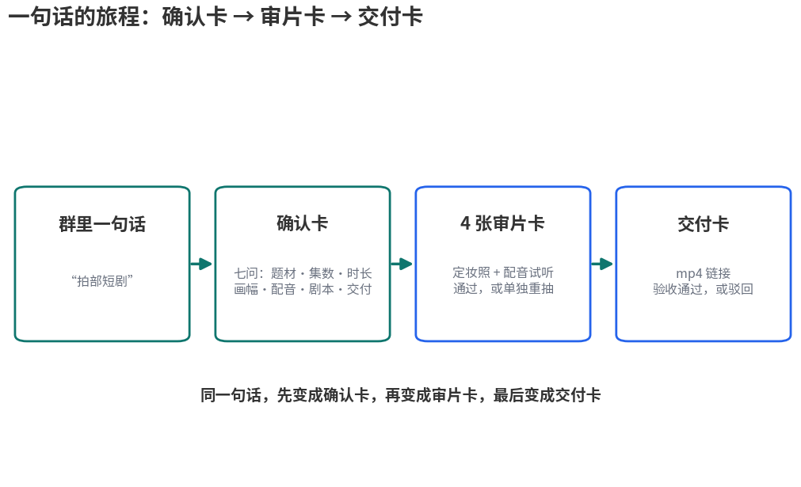

# 群里一句话，12 集短剧就开拍了

来源：https://video.anp.pub/

先说最离谱的一句：群里一句话，12 集短剧就开拍了。剧本、定妆照、配音、成片——三台机器人自己接活、自己交活，人只在关键地方点两下按钮。同一句话，先变成一张确认卡，再变成 4 张审片卡，最后变成一张交付卡。

这篇文章讲的就是这句话背后的逻辑：任务网是干什么的。答案就一句话：**把一件大事拆成小事，派给对的人（或者对的机器人），每一步都留证据，花的每一分钱都有数。** 短剧就是拿来说明这句话的例子。

## 一、先说结论：任务网是干什么的

打个比方。任务网像一个车间主任加一条流水线。你交给他一句话，他干六件事：拆、派、闸、算、验、记。

- **拆**：把「拍一部短剧」拆成能干的小活。
- **派**：把小活派给干这活的人，或者机器人。
- **闸**：在关键地方设检查站，过不了就停下来等人。
- **算**：预算先定好，花了多少、超了怎么办，都有规矩。
- **验**：干完的活有人验收，过就过，不过就返工。
- **记**：每一步都记下来，出问题能回头查。

下面六章，一章讲一件事，每件事都拿短剧当例子。

图 1：任务网的六件事。一句话进来，12 集出去。

## 二、拆：一句话怎么变成 12 集 × 16 环节

拆单像切蛋糕。不是切一刀就完事，是先切成 12 块（集），每块再切成 16 小块（环节），每集 4 个分镜并行推进。切完之后，每集都是一张独立的工单——一集出问题，卡在那一集，不影响另外 11 集。

图 2：12 集 × 16 环节，192 道工单。第 1 集已经成片。

**案例 1：《持械入秦》第 1 集。** 拿一集已经跑完的当例子：古风仙侠题材，《持械入秦》第 1 集「墨刃破函谷」。这是拆出来的最小单位长什么样：

| 项目 | 数值 |
| --- | --- |
| 题材 | 古风仙侠 |
| 分镜 | 5 个 |
| 时长 | 69.41 秒 |
| 画幅 | 1080×1920 |
| 帧率 | 30 帧/秒 |
| 编码 | H.264 / AAC |
| 成片大小 | 4.6 MB |
| 机器评分 | 96 分 |
| 主观评分 | 4.8 分（满分 5 分） |

图 3：《持械入秦》第 1 集第 3 镜「连弩惊弦」的成片截图。首帧定格、剧本、配音都在一帧里，右下角那行小字是海报大师实时合成的。完整成片（69.41 秒）点这里看：https://video.anp.pub/media/exec-01M7RY7GHCXJHC2A1MPEFMFSEX-ep-01/final.mp4

成片就挂在公开的单集页上，点开就能看。这集的特别之处不在分数，而在于它是从群里一句话长出来的：同一句话，先变成一张确认卡，再变成 4 张审片卡，最后变成一张交付卡，每一步都有记录，卡在哪一步都能回头查。

拆的好处就一个：大事变小事之后，每件小事都有人能接、有人能验。没拆之前，「拍一部短剧」是一句空话，谁也不知道从哪下手；拆完之后，12 集、16 道环节、4 个分镜，每一件都有名字、有单子。

## 三、派：三台机器人怎么接活

派单像餐厅传菜。服务员接单，菜按单子分给炒菜的、切菜的、摆盘的，谁也不抢谁的活。短剧这边，服务员是总控机器人，炒菜切菜摆盘的是另外两台：

| 机器人 | 干什么 | 在哪接活 |
| --- | --- | --- |
| 短剧总控机器人 | 接单、发确认卡、发审片卡、发交付卡 | 群里 |
| 海报大师机器人 | 出定妆照和海报 | 接总控的单 |
| LiveAd 视频机器人 | 渲染视频、配音、剪辑成片 | 接总控的单 |

图 4：三台机器人。总控在群里接单发卡，两个在后面干活。

总控是唯一一个在群里说话的，剩下两台在后面干活，不直接跟人对话。活是怎么派到它们手里的？每个环节都挂出来，谁有空谁领——海报的活挂给海报大师，视频的活挂给视频机器人，领了就干，干完就交。机器人每 60 秒看一眼出片进度，首集一出片就发审片卡，不用人在旁边盯着刷新。

分工的好处是每一台只干一件事：总控坏了，换一台总控就行，海报和视频不用动；视频渲染慢了，也只影响视频那一环。

还有一点要说清楚：机器人只做传话和按钮。它不算分、不碰业务库、不推进门、不碰计费状态。派活、审片、验收这些事，还是人点的按钮说了算。

## 四、闸：2 万那条线是干什么的

闸像高速收费站。2 万以下是 ETC，自动抬杆；2 万以上要走人工窗口。短剧这边，合同总额不到 2 万，机器自己放行；超过 2 万，就要人来确认。闸的好处不是省钱，是让机器自己知道什么时候该停下来等人——2 万这条线，就是机器和人的分界。

立项那张七问确认卡，也是一道闸。开拍之前先问七个问题：题材、集数、单集时长、画幅、配音、剧本、交付。七个问题答清楚了，点「确认立项」，订单才发出去。没答清楚，拍不了。

**案例 2：《西游后记》剧本确认卡。** 11 月 18 日 19:20 发出的这张卡，是哑火修复后第一次全流程走通的证据——闸门本身也得有人验，验过了才知道它真拦得住、也真放得行。

防误触也是一道闸。群里没 @ 的消息、机器人自己发的消息，一律忽略。之前小时报的机器人就被误触过，所以这道闸是吃过亏之后加上去的。

| 项目 | 数值 |
| --- | --- |
| 集数 | 12 集 |
| 每集环节 | 16 道工单 |
| 每集分镜 | 4 个，并行推进 |
| 预算闸门 | 合同总额 ≤2 万元自动过闸 |
| 这一单实际花销 | 只占预算的 1.8% |

## 五、算：预算是怎么管的

算像家里的账本。每一笔花销都记着，超了就停。短剧这边，预算分四步管：

1. **先定上限**。开拍之前先定三样：合同总额上限、模型推理 Token 预算上限、预算归属哪个成本中心。上限定死了，后面才有得算。
2. **受理后冻结**。订单一受理，平台的账就冻结了：执行过程只改自己的映射表，绝不碰平台的闸门和三态。意思是，活干到一半，钱的那本账是锁死的，谁也改不了。
3. **超了有三档保护**。花超了怎么办？分三档，由轻到重：

| 保护动作 | 机器干什么 | 大白话 |
| --- | --- | --- |
| 预警并封顶 | 先提醒，再把花销封住 | 还能干，但不能再多花了 |
| 挂起并告警 | 停下来，等人来看 | 先停下，等人拍板 |
| 拦截后续派单 | 直接不派新活了 | 钱不够了，新活不接了 |

4. **用量账按机器人算**。每台机器人花了多少资源、多少 Token、多少时间、多少钱、一次通过率多少，都聚合成一张账。下次派活，先看这张账：谁干得好又便宜，活就多派给谁；谁又贵又慢，就少派。

图 5：预算。这一单只花了 1.8%，三档保护都没用上。

这一单只花了预算的 1.8%，三档保护都没用上。但没用上不等于没有——预算这东西，平时看不见，出问题的时候，全靠它兜底。

## 六、验：审片卡和交付卡是干什么的

验像质检员。每一道菜出锅都要尝一口，不好吃就回锅。短剧这边，质检分两道：

- **分镜审片卡**：首集出片后发 4 张，每张是定妆照加配音试听。点通过，或者单独重抽某一个分镜——只返工那一个，不用整集重拍。
- **成片交付卡**：4 镜全部通过，才发成片交付卡，里面是 mp4 链接。飞书卡片不能内嵌播放视频，所以只给链接。点验收通过，或者驳回。

图 6：一句话的旅程。确认卡 → 审片卡 → 交付卡，每一步都有人能叫停。

**案例 3：C1 分镜审片卡。** 这是群里最常见的卡——首集一出片它就出现，审片的人点通过或者重抽，剧就往下走。重抽只动一个分镜，是这套验收最省钱的地方：错在哪就改哪，不用推倒重来。

确认、审片、验收不按固定角色分。群里的人都可以点这些按钮——谁在现场谁就审，不用等某个特定的人。这个口径是拍板过的：角色灵活，白名单校验保留，不是群成员点按钮照样拒绝。

## 七、记：每一步都有记录

记像快递单号。每一个包裹都有单号，丢了能查到卡在哪一站。短剧这边，同一句话的每一站都有记录：确认卡、审片卡、交付卡，订单、合同、预算、用量账。卡在哪一步，翻记录就知道；谁点的通过、谁点的重抽，也都记着。

公开的生产车间页，就是把这些记录摊开给你看：实时运行态和回放都能看。点开它，看到的不是一张效果图，是一条正在跑的流水线，每一步走到哪了、谁领了哪道环节、花了多少钱，都在上面。

记的好处，平时看不出来，出问题的时候才知道：不用靠人回忆「当时是谁让过的」，翻记录就行。

## 八、演示之后还没做完的事

上面这些，是 11 月 20 日那场演示里跑通的东西。那场演示我演短剧，老周讲任务网。演示完了不等于做完了。这篇写的时候，还有三件事没落袋：

1. **单集页有个已知的小 bug**。成片能看，但单集页上有处显示问题，还在修。
2. **确认卡过期保护还在评审**。现在的确认卡没有过期保护，旧卡一直能点；修法是给确认卡加过期时间，过期了就点不了，方案还在评审。
3. **按题材出图还没做完**。短剧的题材只有三个，写死的：赛博法务（默认）、古风仙侠、都市商战。改题材只改文字，不改图。演示的时候，海报是按通用做法出的，题材感主要靠文案和配音撑着。等按题材出图做完，同一个题材从海报到成片才能一眼认出来。

这三件都不影响演示那天跑通的东西，但都影响以后能不能放心交给别人用。演示是证明「能跑通」，这三件是证明「能放心用」。下一篇写到它们的时候，应该已经合进去了。

---

回到开头那句话。任务网的逻辑就是六件事：拆、派、闸、算、验、记。一句话进来，12 集出去，中间每一步都有人能叫停，每一分钱都有数。

群里一句话，12 集短剧就开拍了。这句话的后半句是：开拍之后，每一步都有人能叫停。
