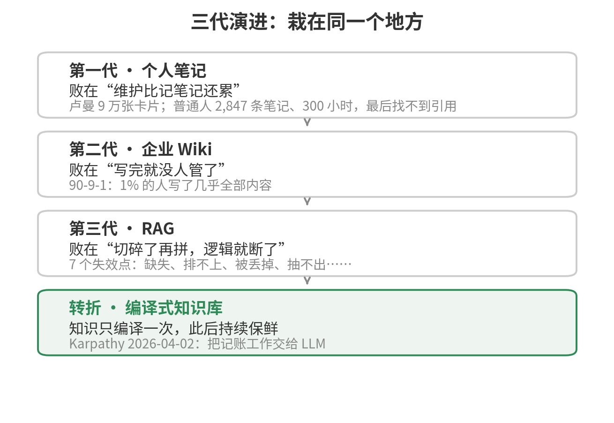
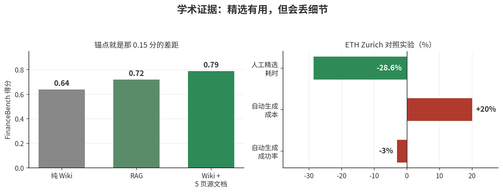
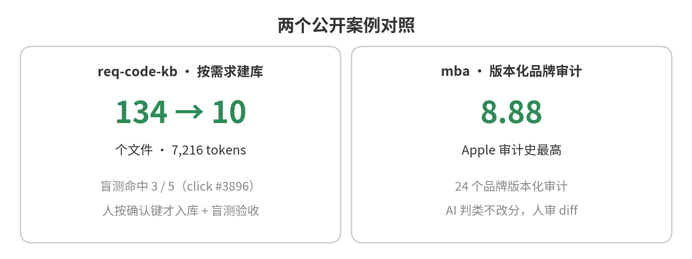

# 别再往知识库里倒文档了

先说最扎心的一句：大部分知识库不是死于没人写，而是死于写完了没人用。

新人接手一个老系统，Wiki 里什么都有，就是找不到要改的那一行；搜出来的十篇文档里三个数字互相矛盾，到底信哪个，没人说得清。于是 Wiki 越写越厚，人越来越不信，最后谁也不翻了。

这篇讲四件事：三代知识库是怎么烂尾的；2026 年 4 月一个帖子为什么让所有人回头看这个问题；学界到底测出了什么，正反两面；以及一个能跑通的做法、两个公开案例、四条铁律。数字全部带出处。

作者：张路 ｜ 2026-11-25 ｜ 来源：本文浓缩自《项目知识库：从“存不下”到“换人能复跑”——背景、演进、证据与实践》（约 3.9 万字）

## 一、知识库不是书堆，是编好的地图册

先破三个误区。

**误区一：知识库就是搜索框。**搜索框解决的是"找得到"，项目里真正的难题是找得到的东西对不对、能不能直接用。你问"这个接口的超时时间是多少"，搜索框给你十篇提到"超时"的文档，三个数字互相矛盾，信哪个？它不回答。

**误区二：知识库就是 RAG 向量库。**RAG 是把一本厚书撕成一页一页的碎片，贴上编号塞进柜子，提问时挑几张最相关的拼在一起交给 AI。它能干很多事，但知识库不是它：RAG 是"现找现拼"的检索技术，知识库是"提前编译好"的成果物。

**误区三：知识库就是把文档都倒进去。**倒进去的越多问题越大：重复的、过时的、互相矛盾的、已经废弃的，全混在一起。AI 读到这样的库，不是变聪明，是变糊涂。

那知识库到底是什么？打个比方：**不是书堆，是编好的地图册；不是菜市场，是按菜谱备好的料。**它有四条：编译好的（不是原始文档的堆积，而是读过、提炼过、整理成的结构化内容）；带链接的（每一条结论都能追溯到来源，哪份文档、哪行代码）；自我维护的（代码变了库要跟着变，发现错了有人改、有人审）；AI 直接读的（最终用户不只是人，更是 AI，干活时直接把知识库当案头资料读）。

一句话：**知识库是精选的、带源码锚点的、经人工验证的项目百科——按真实需求一点点建起来，做完能回流，越用越聪明。**"源码锚点"就是每一条业务规则都标明它在代码里的位置，哪个文件、哪个方法、第几行，没有锚点的规则，AI 只能靠猜。"回流"就是做完一个需求，顺手把新发现写回库里，库越用越新。

## 二、三代知识库，栽在同一个地方

知识库至少经历了三代。每一代出发点都很好，也都栽在了同一个地方——**不是"存不下"，而是没人、没有机制让它保持正确、保持被用**。

**第一代：个人笔记，败在"维护比记笔记还累"。**最有名的是卡片盒：德国社会学家卢曼一生写了约 9 万张卡片，靠手工编号和交叉引用，写出了 70 本书、400 多篇论文。但代价是每天花大量时间归档，相当于给自己找了第二份全职工作。普通人是另一副样子：有实践者存了 2,847 条笔记、投入约 300 小时，最后连一条明明记得存在过的引用都找不到。打个比方，这就像记账：记账本身不是目的，是为了管好钱；但如果记账花的时间比赚钱还多，这套方法就反噬了。

**第二代：企业 Wiki，败在"写完就没人管了"。**页面写完即冻结，代码一变就过时；同样的内容写了好几份，不知道哪个是权威版；约 1% 的人写了几乎全部内容（所谓"90-9-1"规律：90% 的人只看、9% 的人偶尔改、1% 的人写了几乎所有东西）；搜索返回 200 条无关结果，找东西比不找还累。

**第三代：RAG，败在"切碎了再拼，逻辑就断了"。**2024 年，Barnett 等人在 CAIN 会议上发表了一篇经验报告，基于三个真实案例，把 RAG 的失效点逐个定位出来：

| 失效点 | 人话解释 | 打个比方 |
|---|---|---|
| FP1 缺失内容 | 答案根本不在库里，AI 却硬着头皮编一个 | 冰箱里没有鸡蛋，却非要给你煎蛋 |
| FP2 排不进前几名 | 答案在文档里，但检索时没排进前几名，AI 永远看不见 | 书在图书馆里，但不在推荐架上 |
| FP3 合并时被丢掉 | 检索到了，但在拼进上下文时被挤出去了 | 菜买回来了，做饭时忘在袋子里 |
| FP4 在上下文里却抽不出来 | 答案就在给 AI 的材料里，但材料太杂、互相矛盾，AI 没抽出来 | 答案写在卷子上，但周围全是涂改 |
| FP5 格式错误 | 答案对了，但格式不对，没法用 | 钥匙对了，但插不进锁孔 |
| FP6 详略不当 | 回答得太啰嗦或太简略 | 问一句"几点开会"，回你一整本会议纪要 |
| FP7 答案不完整 | 只答了一半 | 菜谱只写到一半 |

作者的结论很关键：**RAG 的可靠性不是设计时一次到位的，是在运行中一点点演化出来的。**别指望搭一个 RAG 就万事大吉，它需要持续的验证、纠错和调优——而这，恰恰就是"知识库"要补上的那块拼图。

## 三、转折：Karpathy 说，编译一次

2026 年 4 月 2 日，Andrej Karpathy（前特斯拉 AI 负责人、OpenAI 创始成员）在 X 上发了一篇帖子，标题就叫《LLM 知识库》。48 小时内约 1,600 万浏览，到 9 月下旬累计约 2,190 万浏览、约 6.1 万赞、10.86 万收藏。两天后（4 月 4 日），他在 GitHub 上贴了一个 Gist，里面没有代码，只有一份"想法文件"，讲他到底想干什么。

他的核心主张只有一句话：

> "不要每次提问时都重新去原始文档里检索，而是让 LLM 把原始资料**一次性编译**成一个持久的、互联的 Markdown wiki，之后只查这个 wiki。知识只编译一次，此后持续保鲜，而不是每次查询都重新推导。"

这个主张为什么引起这么大反响？因为它正好踩在三代失败的痛点上：**把维护的记账工作交给 LLM，人只负责策展资料、提好问题、做判断。**

他的设计分三层，打个比方，就像一个图书馆的三层楼：第一层是原始资料，不可变、只读，是事实来源，就像善本库房，书只能看不能改；第二层是编译好的 Wiki，LLM 生成的页面互相交叉引用，这是读者真正翻的书；第三层是规则文件，规定 Wiki 的结构、页面格式、新资料怎么进、冲突怎么处理，相当于图书馆的编目规则。三个操作：摄入（新资料先进原始层，LLM 读完更新所有相关页面）、查询（查索引、读相关页、综合作答，好答案再写回 Wiki）、体检（定期健康检查，找矛盾、找过时的主张、找没人链接的孤儿页）。他自己的规模是单个研究主题约 100 篇文章、约 40 万词，由 LLM 编写维护，他本人几乎不直接写。适用范围他自己也划了界：**"有边界、经过策展的语料"**，不是无界全网。

有两处常被误引，这里按核实过的说法写：第一，**"图书管理员"不是 Karpathy 的原话**，Gist 全文检索不到 "librarian" 这个词，那是评论者、媒体打的比方；第二，**Gist 里没有代码**，它只是一份想法文件。

批评也值得听。帖子下最具分量的公开回复来自 Twitter 联合创始人 Jack Dorsey，称其为"a great idea file"（伟大的想法文件）。Gist 评论区最受重视的实质性批评，是一位叫 @skynet 的评论者提出的四点：内容目录在约 100–200 页时会撑爆上下文窗口；大文档需要预检索——讽刺的是，那本身就是 RAG；矛盾解决规则没定义（两个来源打架，听谁的？）；想法文件故意写得很抽象，既是优点也是弱点。

## 四、学界测出了什么：正反两面都要讲

这一章是全文最"硬"的部分：学界到底测出了什么。数字全部带出处，表述口径按论文原文校准过。

**正方：给对的上下文，比给多的上下文更重要。**2026 年 6 月，Zhang 等人发表了 SWE-Explore，规模是 848 个真实 issue、203 个开源仓库、10 种编程语言。最常被引用的数字是 **r = +0.95**，但这个数字很容易讲错，必须准确表述：它是**"上下文效率"与"下游修复成功率"的相关系数**——给出的行里面有多少是真正核心的，这个"准度"越高，修好的可能性越高，这是在 150 个 issue 的共享子集上测出来的。它**不是**"结构化地图本身"与成功率的相关系数。结构化方法的证据是另一条：结构感知的 CoSIL 行召回达到 **0.788**，而通用 Agent 只有 **0.15–0.19**——大约 4 倍。其他指标同样高：第一次命中就有用的比例 +0.928，命中正确文件 +0.925。一句话：**"少而准"比"多而全"更能预测成功。**

微软的 FastContext 也给出类似结论：只给最小证据，token 最多降六成。Lulla 等人的实测是：一份人工写好的精简项目说明，能让 AI 干活的中位耗时直降 **28.6%**。

**反方：必须诚实讲的三组数字。**第一，纯 Wiki 会丢细节：FinanceBench 实测，纯 Wiki 只有 **0.64**，低于 RAG 的 **0.72**。但 Wiki 加上它引用的 5 页源文档，立刻涨到 **0.79**——锚点就是那 0.15 分的差距。第二，自动生成的上下文文件反而帮倒忙：ETH Zurich 的对照实验，LLM 自动生成的上下文文件，成功率反而下降 **3%**、成本上升 **20%** 以上；只有人工精选编写的才正向提升。第三，图方法不是万能：GraphRAG-Bench（4,076 道题）显示，简单事实检索，文本块 60.9 对图方法 60.1，基本平局；复杂推理 42.9 对 53.4，图方法胜；上下文摘要 51.3 对 64.4，图方法胜。

综合判断三句话：**精选有用，但编译会丢细节；自动生成会帮倒忙；没有单一赢家，拼接最好。**

## 五、能跑通的做法：先修一条能通车的路

落到一家公司的存量系统上，还要过三道具体的坎：业务规则不写在文档里，散在代码、流程和老师傅的脑子里；存量系统动辄几百张核心表，全貌没人说得清；私有框架没有公开资料，AI 读不懂，靠现翻代码又太慢。

面对这三道坎，能跑通的路子是**渐进式**：放弃"先花几个月做全量建图、再干活"，改成按真实业务需求建最小完备上下文，跑通全流程，再靠"知识飞轮"滚动扩充。打个比方：不是先把整座山测绘完再修路，而是先修一条能通车的路，修路的过程本身就是在测绘。

落地分三步走：**先拿 1 个已上线需求做模拟实战、搭出底座；再拿 1 个真实新需求跑通全流程；最后滚动 10 个以上的需求批量沉淀。**

还有三处配套的做法。**二级索引**：总目录加各目录下的说明页，单文件超 500 行自动拆目录——这是对"内容目录会撑爆"批评的直接回答。**四档开发模式**：按需求复杂度选档，跨多仓、状态机、核心安全走全套，单模块小修走轻量，配置类变更和纯 UI 微改再往下减档——不是改个按钮文字也要走全套流程。**三层内容**：业务场景主干只用业务语言，不抄物理表名；知识原子底座放术语、接口、规范；代码锚点做胶水，每条隐藏逻辑必须标清"文件路径 :: 方法名 :: 行号"。

## 六、两个公开案例

**案例 1：req-code-kb——做一道菜，只备这道菜的料。**开源项目，MIT 协议。做法是按需求建库、不按整仓倒：一个需求建一个"最小完备上下文"知识页。盲测验收用 click 的一个真实需求（给 `CliRunner.invoke()` 加 `context_settings`，解决 `color` 名字冲突）：134 个文件里只列出 10 个、7,216 tokens，5 个真实改动文件命中了 3 个，检索首条得分 0.261。方法是标准库解析加排序思路自写，加 8,000 tokens 预算，再加两道人工门：人按确认键才入库，盲测验收不过不算数。诚实说缺口：漏了 `docs/testing.md`，原因是整篇长文档当一个整体算分，信号被稀释了，修法是按小节切分再索引，还没做完。

**案例 2：mba——分数变了，能立刻说出是哪条消息变的。**开源品牌审计库，网站 mbabrand.com。24 个品牌做版本化审计：5 位评委按 7 个维度、5 个镜头独立打分、互不可见，再由主评委合成。更新机制叫 EVOLUTION：有旧报告时，只消费未消费的舆情事件、只重打变了的维度，版本号加 1，旧版快照永远留着。最关键的一条规则是**AI 判类不改分，人审代码 diff**——合并就是人工闸门。

实测数字：Apple v1（2026-07-16）221/250，到 v2（2026-07-20）222/250，**8.88 分，审计史最高**；唯一移动的是 Signal 维度 7.8→8.0，原因是全线涨价加上 Apple Intelligence 国行过审。奇安信 v2：v1 引用 2023 年口径"约 67 亿年营收"，FY2025 年报实际营收 **43.92 亿**，总分 185→175/300。舆情处理：145 条候选里采纳 62、丢弃 77、低置信 6。

| 仓库 | 一句话定位 | 绝招 | 规模（截至 2026 年 11 月下旬） |
|---|---|---|---|
| req-code-kb | 按需求建最小上下文的代码库 | 人按确认键才入库 + 盲测验收 | 134→10 文件、7,216 tokens、盲测 3/5 |
| mba | 版本化品牌审计 | AI 判类不改分，人审 diff | 24 品牌，Apple 8.88 为审计史最高 |

## 七、四条铁律，和一句验收标准

写了这么多，最后收束成四条铁律。它们不是口号，是前面所有案例、论文、失败模式里共同沉淀下来的东西：

1. **按需求建，不整仓倒。**只给当前要做的需求建"最小完备上下文"。SWE-Explore 的实测证明，给 AI 的上下文越精干，修 Bug 成功率越高，相关系数高达 r = +0.95。
2. **正文讲人话，必须挂代码锚点。**FinanceBench 的实测证明：纯 Wiki 只有 0.64，但 Wiki 加上它引用的 5 页源文档，立刻涨到 0.79——锚点就是那 0.15 分的差距。
3. **AI 干体力活，人定标准并拍板。**抽取、整理、比对交给 AI；但哪些能入库、口径对不对、能不能上线，必须由人或写死的规则脚本拍板。ETH Zurich 的实测给所有盲目自动生成泼了冷水：让 AI 自动生成上下文文件，成功率反降 3%、成本暴涨 20% 以上。
4. **做完就回流，越用越聪明。**改代码上线前顺手更新知识页，再配 30/90/365 天保鲜复查。人工写好精简项目说明，AI 干活中位耗时直降 28.6%。

验收分三层，层层递进：**听过不算 → 跑通解疑 → 复跑才算沉淀资产。**唯一的验收标准只一句话：**另一个人只拿你的模板和填法指南、不问作者也能复跑。**

最后是诚实清单，写给想照着做的人：检索会漏（长文档和切碎都有代价）；编译会丢细节，AI 编造的内容一旦进了 Wiki、又被别的页面引用，会像谣言一样跨页传播，唯一的解法是锚点加人工验证；成本不是免费的，建一次图谱花了 281 分钟（播客语料），推广前先算一笔账：编译一次的成本，换回来多少次查询的节省？

送读者三句话：

- **丢的不是文件，是来龙去脉；**
- **没锚点 AI 靠猜，有锚点 AI 靠查；**
- **做完的需求回流进库，越用越聪明。**

来源：张路，《别再往知识库里倒文档了》，2026-11-25。本文浓缩自《项目知识库：从“存不下”到“换人能复跑”——背景、演进、证据与实践》（约 3.9 万字），数字均带出处；开源案例见 req-code-kb（https://github.com/zhanglunet/req-code-kb）与 mba（https://mbabrand.com）。
